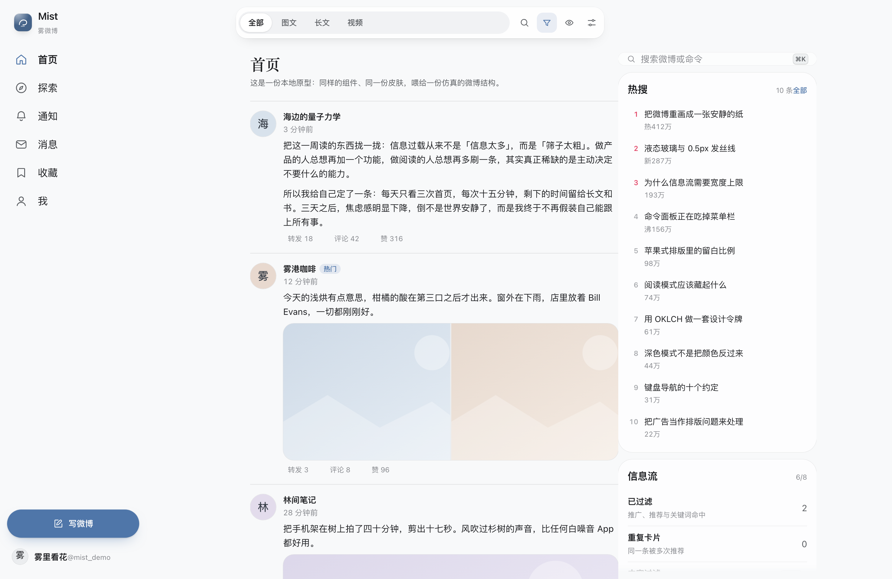
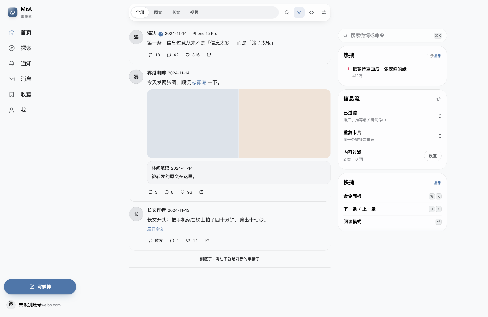
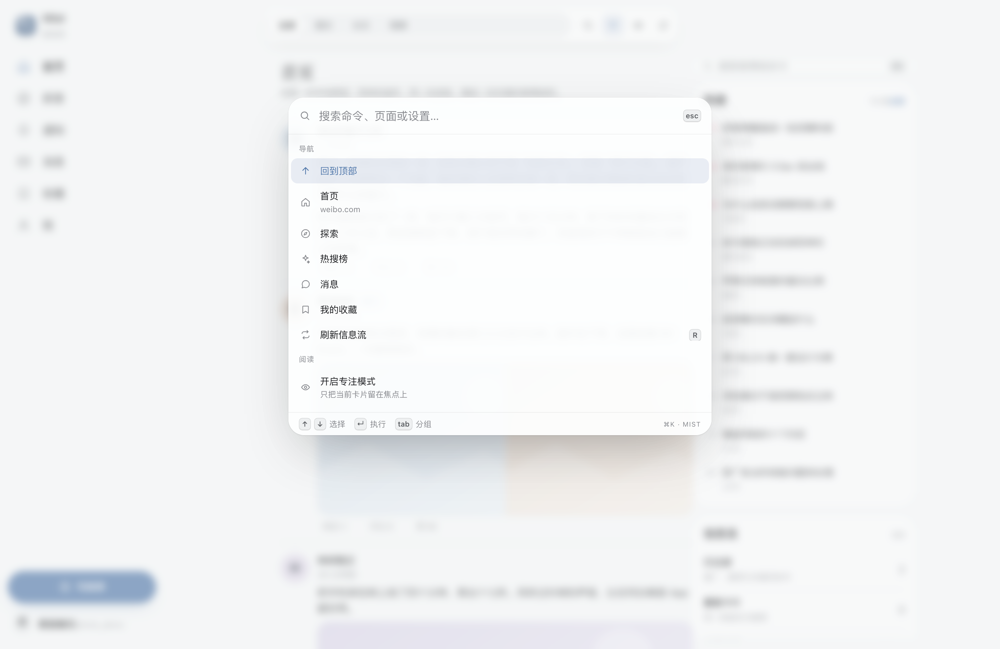
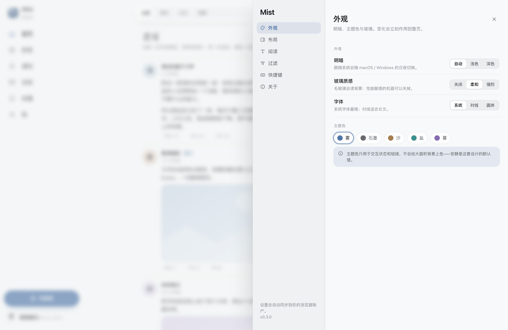
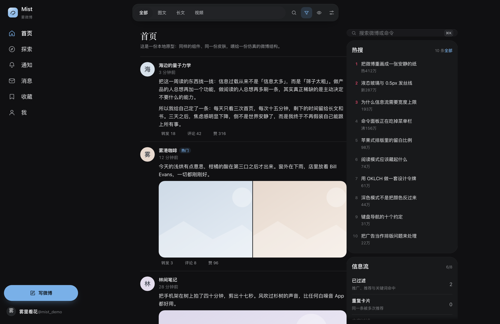
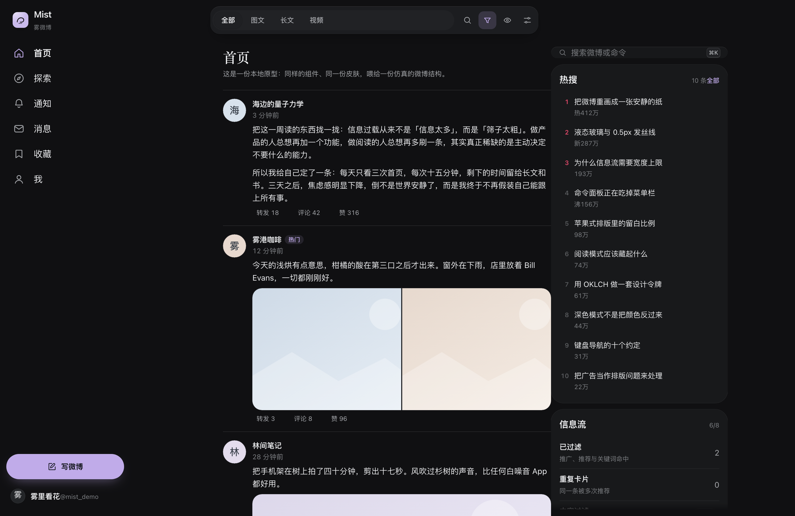
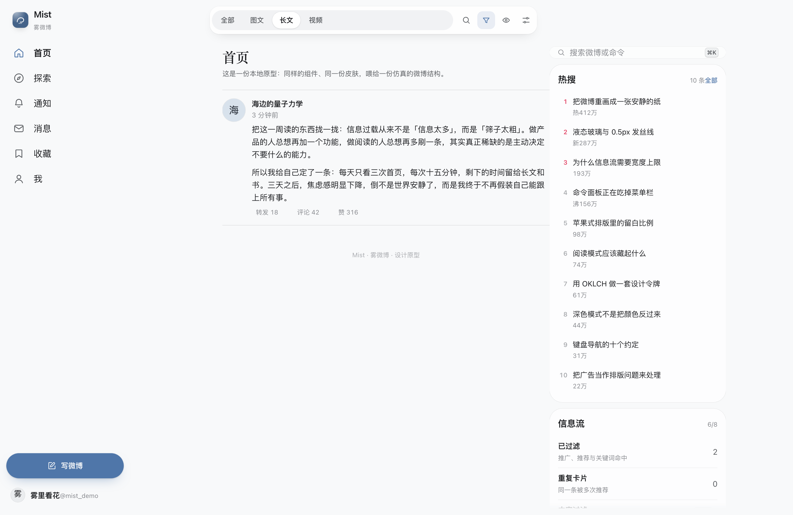

# Mist · 雾微博

> 把微博重画成一张安静的纸。**Apple 式排版 + X 式三栏 + 液态玻璃**，顺手清掉广告与噪音。
> A calm, Apple-flavoured reading layer for `weibo.com` — Manifest V3, no build server, no telemetry.

<p align="center">
  
</p>

Mist 不是「又一个微博客户端」，也不是把整站塞进 iframe 的外壳。它做两件事，顺序不能反：

1. **接管页面**：按结构（不是类名）找到时间线，把页面其余部分——顶栏、二级栏、自定义分组、发博框、
   二级 tab、右栏、浮动件——整体隐藏。所以装好之后看到的是 Mist 的页面，而不是「原生页面上浮了一层」。
2. **重画时间线**：首页的时间线不再使用微博的卡片，而是从微博自己的 JSON 接口取数据
   （`/ajax/feed/friendstimeline` 等，走页面内脚本，带登录态），用 Mist 的组件重新渲染。
   头像、正文、九宫格、转发引用、视频、点赞，全部是 Mist 自己的 DOM 与令牌。

其余路由（消息、设置、个人页）没有对应的数据模型，就用第 1 步的接管把原生列表搬进列里——
这样既不会错位，也不会把不认识的页面变成空白。删掉扩展，页面立刻回到原样。

| | |
|---|---|
| 形态 | Chrome / Edge 扩展（Manifest V3，`minimum_chrome_version: 111`） |
| 体积 | 运行时约 48 kB（zip），唯一的运行时依赖是 Preact |
| 网络 | 不新增任何第三方请求。时间线、热搜、头像、点赞、发博都调用微博自己的接口（页面内上下文，带你的登录态） |
| 数据 | 设置存在 `chrome.storage.sync`，过滤词只在本机 |
| 许可 | MIT |

---

## 一、微博原页面的十个痛点，以及 Mist 的处理

这些不是想象出来的问题清单，每一条都对应代码里的一个开关或一段样式。

| # | 微博网页版的痛点 | Mist 的做法 | 对应设置 |
|---|---|---|---|
| 1 | 顶栏、二级栏、自定义分组、发博框、二级 tab、右栏一起挤在一屏，时间线只剩中间一条 | **结构式接管**：页面按结构识别后整层隐藏，只留 624px 的正文列；关掉「接管版式」可恢复原生页面 | `layout` |
| 1b | 原生卡片排版不是给人读的：字号小、行距紧、间距不统一、图片边缘磕碰 | **时间线由 Mist 自己画**：数据来自微博接口，卡片是 Mist 的组件——15px 正文、1.7 行距、4px 基准的间距、14px 圆角媒体、统一的发丝线节奏 | 无需开关 |
| 2 | 广告、推广、「推荐关注」混排进时间线，划到一半才看出是广告 | 逐卡片打标签（`promoted` / `recommend`），默认隐藏；也可以在过滤面板里按 **超话 / 投票 / 抽奖 / 直播 / 任务** 逐类关掉 | `hideAds` `hideSuggested` `filters` |
| 3 | 「展开全文」把长文切成两段，每次都要多点一次 | 可自动点开；`J/K` 移动光标后按 `↵` 进入**阅读模式**：单栏、衬线、字号与行距可调、Esc 退出 | `autoExpand` `fontScale` `lineHeight` |
| 4 | 深色模式只覆盖一半，图片和卡片还是白的；夜里视频自己开始播 | 一套 OKLCH 令牌覆盖原生卡片、图片、输入框、弹层；视频默认不自动播放，由 MAIN world 脚本兜底暂停 | `theme` `autoplay` |
| 5 | 右栏堆了四五个模块，热搜/话题/会员/游戏入口全在抢注意力 | 右栏只留三块：**热搜**（真实接口）、**信息流统计**、**快捷命令**；窄屏自动收起 | `aside` |
| 6 | 想找的功能藏在设置页第三层，很多人不知道快捷键存在 | **命令面板**：`⌘K` / `/` 唤起，三十余条命令，模糊搜索、分组、`↑↓` 选择、`↵` 执行 | `shortcuts` |
| 7 | 长文没有阅读环境：两端对齐、行距紧、旁边永远有东西在动 | 阅读模式 + 顶部 2px 进度条；**专注模式**让悬停的那条保持清晰，其余退到背景 | `progressBar` `focusMode` |
| 8 | 刷新一次，读了半小时的位置没了 | 记住每条页面的滚动位置（`sessionStorage`），返回时回到原处 | `rememberScroll` |
| 9 | 侧边栏占着 248px 却只有图标和文字，宽屏浪费，窄屏挤压 | 侧边栏可收成 76px 图标轨；列宽、间距、留白全部由令牌推导，1280 / 1440 / 1920 都不需要单独适配 | `railCollapsed` |
| 10 | 全站只能用鼠标 | `J/K` 移动、`↵` 阅读、`O` 新标签打开、`S` 收藏、`C` 发博、`G G` 回顶、`T` 切明暗、`F` 专注、`?` 快捷键表 | `shortcuts` |

---

## 二、它长什么样

**默认（浅色）** — 左侧导航 / 中央时间线 / 右侧热搜，全部落在一条基线上：



上面这张来自 `tests/fixture/home`：同一份构建产物，把微博的 `/ajax/feed/*` 换成固定 JSON 后由
Mist 的组件渲染——名字、时间、九宫格、转发引用、计数、点赞状态都是数据驱动的，没有一个类名来自微博。


**命令面板** — Raycast 式，`⌘K` 或 `/` 唤起，分组 + 模糊匹配 + 键盘提示：



**设置** — 抽屉式，六段：外观 / 布局 / 阅读 / 过滤 / 快捷键 / 关于：



**深色与暮色主题**（`暮 = dusk`，深色下偏冷紫）：




**长文视图** — 中央列只留长文，用于连续阅读：



> 截图来自 `dist-demo/`：同一个 `Shell` 组件、同一份 `weibo.css`，喂给一份仿真微博结构。
> 生成命令见下文「本地开发」。

---

## 三、安装

### 从 release 安装

1. 下载 [Releases](https://github.com/Snowkei/weibo-mist/releases/latest) 里的 `mist-0.3.0.zip` 并解压；
2. `chrome://extensions` → 打开「开发者模式」→「加载已解压的扩展程序」→ 选择解压出的目录；
3. 打开 <https://weibo.com>，页面会重排成 Mist。

### 从源码安装

```bash
git clone https://github.com/Snowkei/weibo-mist.git
cd weibo-mist
npm install
npm run build          # → dist/
```

然后在 `chrome://extensions` 里加载 `dist/`。

> 首次打开微博若停留在旧标签页，刷新一次即可（content script 在 `document_start` 注入）。

---

## 四、键盘

| 键 | 作用 |
|---|---|
| `⌘K` / `Ctrl K` / `/` | 打开命令面板 |
| `⌘,` / `Ctrl ,` | 打开设置 |
| `J` / `K` | 下一条 / 上一条（光标跟随，`Enter` 进入阅读） |
| `↵` | 阅读模式打开当前条 |
| `O` | 在新标签打开当前条 |
| `S` | 收藏当前条 |
| `C` | 跳到发微博输入框 |
| `G` `G` | 回到顶部 |
| `T` | 切换明暗 |
| `F` | 专注模式 |
| `?` | 快捷键表 |
| `Esc` | 逐层关闭（面板 → 抽屉 → 阅读 → 光标） |

全部可在设置里关掉（`快捷键` 开关）。命令面板里的每一条也都能用鼠标点。

---

## 五、功能清单

**导航** — 首页 / 探索 / 热搜 / 消息 / 收藏 / 我；发微博；账号卡片。

**阅读** — 四视图（全部 / 图文 / 长文 / 视频）；专注模式；自动展开长文；阅读模式（字号 0.85–1.3×、
行距 1.3–2.0）；阅读进度条；记住滚动位置；`J/K` 光标。

**外观** — 明暗（自动 / 浅 / 深）；五套主题色（雾 / 石墨 / 沙 / 盐 / 暮）；三档玻璃（关 / 柔和 / 强烈）；
三套字体（系统 / 衬线 / 圆体）；侧边栏收起；右栏开关。

**过滤** — 广告、推广、客户端下载条、推荐关注一键隐藏；七类内容标签；关键词与作者名单（每行一条）。

**系统** — 命令面板；快捷键表；一键恢复默认；版本与设计说明。

---

## 六、设计

三句话概括 Mist 的设计观（细节见 [DESIGN.md](DESIGN.md)）：

1. **静止时无色。** 默认界面是中性灰阶，颜色只在交互与状态里出现——评论蓝、转发绿、点赞玫红。
2. **用明度分层，不用阴影。** 卡片是「同色的纸」而不是浮起的塑料；分隔靠 0.5px 发丝线。
3. **玻璃只在边缘。** `backdrop-filter` 只给浮层（命令面板、设置抽屉、吸顶的视图切换），正文永远是纸。

所有尺寸、颜色、动效都来自 [`src/styles/tokens.css`](src/styles/tokens.css) 的 OKLCH 令牌，
换主题只是换一组变量。

---

## 七、架构要点

```
weibo.com 页面
├── content.js        ← 增强层（Shadow DOM 外壳 + 原生 DOM 观察与打标）
├── main-world.js     ← 页面主世界：代取热搜/账号接口、兜底停自动播放
└── background.js     ← 工具栏按钮 / 快捷键 → 通知当前标签页
```

- **不改微博的 DOM 结构**，只加 `data-mist-*` 属性，让 CSS 去决定显隐。
- **外壳在 Shadow DOM 里**，微博的全局样式压不进来，Mist 的样式也漏不出去。
- **设置是一个纯数据契约**：`Settings` → `data-mist-*` 属性 + CSS 变量，CSS 是唯一真相。
- **不联网**：热搜和头像由 `main-world.js` 用页面自己的登录态调 `weibo.com` 的接口。

完整说明见 [ARCHITECTURE.md](ARCHITECTURE.md)。

---

## 八、本地开发

```bash
npm install

npm run dev        # esbuild watch：dist/ + dist-demo/
npm run typecheck  # tsc --noEmit（strict）
npm test           # 18 个契约测试（设置、属性层、命令面板排序）
npm run build      # → dist/（扩展本体）
npm run build:demo # → dist-demo/（本地原型页）
npm run shots      # 用本机 Chrome 无头截图 → shots/
npm run zip        # → release/mist-<version>.zip
npm run check      # typecheck + test + build
```

原型页：

```bash
npm run build:demo
npx serve dist-demo    # 或 python3 -m http.server 8788 --directory dist-demo
```

`dist-demo/index.html` 支持一串查询参数，方便调试与截图：
`?theme=dark&tint=dusk&glass=strong&view=long&palette=1&q=外观&sheet=filters&rail=collapsed&aside=0`。

---

## 九、边界与已知限制

- 只做**桌面端**。窄于 1024px 时右栏自动隐藏；不做移动版布局。
- **数据模式只接手首页时间线**（`/`）。探索、个人页、搜索结果仍使用原生内容；点开会走原生弹层或新标签页。
- 接口来自微博网页版自己用的那几个 `/ajax/*`。它们不是公开 API，微博改结构时 Mist 会先失败、再降级：
  读不到数据时正文列会给出「重新读取」，而不是空白。
- 评论列表、图片灯箱还没有自己的实现（点击图片打开大图原链接，评论与转发打开原微博）。
- 原生模式的类名兜底仍在 `src/content/enhance.ts` 顶部；识别不到时间线时页面底部会浮出一条提示。
- 只在 `weibo.com` 与 `*.weibo.com` 的顶层文档生效，iframe 内不注入。

---

## 十、隐私

不采集、不上报、不含第三方分析 SDK。详见 [PRIVACY.md](PRIVACY.md)。

---

## 十一、致谢

- [**xb**](https://github.com/nnecec/xb)（GPL-3.0）—— 本项目的起点。Mist 重写了它的架构
  （从「重渲整站」退回到「增强现有 DOM」），但「微博可以更安静」这个判断来自它。
- [**映间 MARGIN**](https://github.com/jiuyang5354/bilibili-margin)（MIT）—— 液态玻璃、命令面板、
  发丝环与弹簧动效的视觉参考。
- **X (Twitter)** —— 三栏阅读秩序的参考。
- **Apple Human Interface Guidelines** —— 字号阶梯、留白节奏与「材质代替装饰」的取向。

字体与图标：系统字体栈；36 个图标是手写的 1.6px 线条 SVG，没有图标库依赖。

---

## License

[MIT](LICENSE) © 2026 Snowkei
